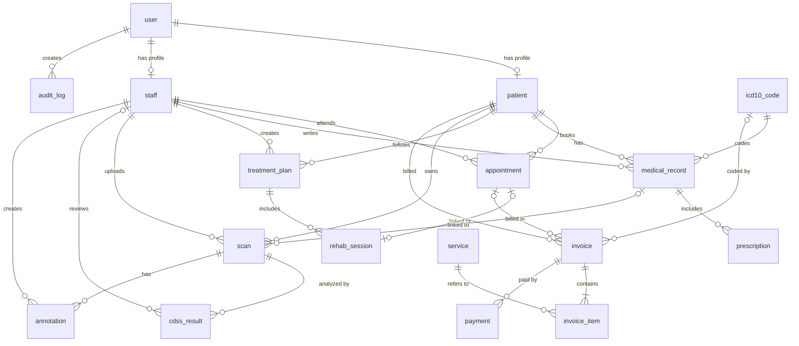

# Orthopedic and Rehabilitation System

A web-based clinical management system for orthopedic clinics and rehabilitation centers. It manages patient registration, appointments, musculoskeletal electronic medical records (EMR), prescriptions, rehabilitation plans, billing, and reports. In Phase 3, it adds an AI-based Clinical Decision Support System (CDSS) for orthopedic scans and an interactive web DICOM viewer, alongside HL7 FHIR R4 data exchange.

> **Note:** This repository is a university course prototype (Healthcare Information System, Team 03, Faculty of Engineering, Cairo University). It is for educational use only and is not a certified medical product.

## Contents

1. [Project description](#1-project-description)
2. [Prerequisites](#2-prerequisites)
3. [Getting started](#3-getting-started)
4. [Run guide](#4-run-guide)
5. [Data schema](#5-data-schema)
6. [APIs](#6-apis)
7. [Demo](#7-demo)
8. [Testing and code style](#8-testing-and-code-style)
9. [License](#9-license)
10. [Acknowledgments](#10-acknowledgments)

Reference documents in [`docs/`](docs):
- [Phase 0 Project Report](docs/Phase%200_Description.pdf) — system overview, tools, team, and code style
- [Phase 1 System Design](docs/Phase_1_System_Design.pdf) — architecture, ER diagram, data dictionary, APIs, and RBAC
- [Phase 2 Runbook](docs/Runbook%20Orthopedic%20and%20Rehabilitation%20System%20%28Phase%202%29.md) — setup, run instructions, and 70 Normal/Edge test cases

---

## 1. Project description

### Project status

| Phase | Scope | Status |
| --- | --- | --- |
| **Phase 0** | System choice, tools, team roles, repository setup, code style | Done |
| **Phase 1** | Task division, layered architecture, 17-table ER diagram, API and RBAC design | Done |
| **Phase 2** | Healthcare system (auth, users, patients, appointments, EMR, rehab, billing, reports, FHIR R4, EMR client) | Done |
| **Phase 3** | CDSS and DICOM system (Orthanc PACS, OHIF viewer, PyTorch AI model, annotations) | Planned |
| **Phase 4** | Final system integration, user guides, and final presentation | Planned |

### User roles

The system uses role-based access control (RBAC) with ownership checks across three roles:

| Role | What the user can do |
| --- | --- |
| **Admin** | Create and manage staff/admin accounts, activate or deactivate users, set service prices, manage invoices and cash/card payments, and view system, patient, and financial reports. Admins cannot read clinical medical notes or scans. |
| **Clinical staff** *(doctor, physiotherapist, radiologist, nurse)* | View and edit patient profiles, manage appointments, write visit records with ICD-10 codes, add prescriptions, create rehabilitation plans and log sessions (pain score and range of motion), issue invoices, view patient reports, and *(Phase 3)* upload DICOM scans, run AI analysis, review findings, and annotate images. |
| **Patient** | Self-register, edit own profile, book and cancel own appointments, view own medical records, prescriptions, and rehabilitation plans, pay own invoices online (simulated), and *(Phase 3)* view own scans and clinician-accepted AI results. |

### Architecture and tech stack

Browser traffic enters through a single Nginx reverse proxy, which routes UI requests to the React web application and API calls to the Flask backend. A standalone EMR client connects only through the HL7 FHIR R4 endpoints to prove standard healthcare interoperability.

| Layer | Technology | Purpose |
| --- | --- | --- |
| **Web application** | React 18, TypeScript, Vite, Tailwind CSS, TanStack Query, Recharts | Clinic portal and dashboards for admin, clinical staff, and patients |
| **EMR client** | React 18, Vite, Fetch (HL7 FHIR R4 JSON) | Separate FHIR-only client for reading patient records and appointments |
| **Reverse proxy** | Nginx 1.27 | Single entry point on port `80`, routing, and request rate limiting |
| **Backend API** | Python 3.12, Flask, SQLAlchemy ORM, Alembic, Flask-JWT-Extended, bcrypt | Business rules, JWT authentication, RBAC, audit logging, and FHIR R4 mapping |
| **Database** | PostgreSQL 16 (`btree_gist`) | Stores users, clinical records, schedules, billing, and append-only audit logs |
| **Terminology & standards** | HL7 FHIR R4, WHO ICD-10 (2019 English) | Standard clinical data exchange and 679 orthopedic diagnosis codes |
| **DICOM & AI *(Phase 3)*** | Orthanc (PACS / DICOMweb), OHIF Viewer, PyTorch, PyDICOM, SimpleITK | DICOM storage, 2D/MPR/3D viewing, and AI scan analysis |
| **DevOps & testing** | Docker Compose, GitHub Actions, Pytest, Jest | Containerized setup, CI checks, and V-Model automated testing |

### Repository structure

```text
.
├── .github/
│   ├── workflows/ci.yml          # CI pipeline: style checks, unit/integration tests, Docker smoke test
│   └── pull_request_template.md
├── backend/                      # Flask REST API, FHIR R4 module, Alembic migrations, tests
│   ├── app/                      # api/v1, auth, fhir, models, schemas, services, utils
│   ├── migrations/               # Alembic database revisions (0001_phase2, 0002_imaging_integrity)
│   ├── scripts/                  # seed.py, load_icd10.py, demo_token.py
│   └── tests/                    # unit, f01_f08, and PostgreSQL integration suites
├── frontend/                     # React + TypeScript clinic web application
├── emr-client/                   # Standalone React HL7 FHIR R4 client
├── cdss-service/                 # AI / CDSS service (Phase 3)
├── imaging/                      # Orthanc and OHIF settings (Phase 3)
├── nginx/default.conf            # Reverse proxy and rate-limiting rules
├── database/seed/                # WHO ICD-10 loader guide and local archive cache
├── docs/                         # Phase 0/1 reports, Phase 2 runbook, and screenshots/
├── docker-compose.yml
├── .env.example
├── LICENSE
└── README.md
```

---

## 2. Prerequisites

### Required software

| Tool | Needed for | Check command |
| --- | --- | --- |
| **Git** | Cloning the repository | `git --version` |
| **Docker Desktop** (Windows/macOS) or **Docker Engine** (Linux) | Running containers | `docker --version` |
| **Docker Compose v2** (`docker compose` with a space) | Starting and stopping the stack | `docker compose version` |
| **Web browser** (Chrome, Edge, or Firefox) | Opening the web app and EMR client | — |
| **`curl`** *(optional)* | Testing API endpoints from the terminal | `curl --version` |

> Optional (only if running tools outside Docker): **Python 3.12**, **Node.js 20**, and **PostgreSQL 16**.

### Machine requirements

- Internet access on the first build to download Docker images, packages, and the WHO ICD-10 archive (if not already cached in `database/seed/`).
- At least 4 GB of free disk space for Docker images and the PostgreSQL volume.
- These five local ports must be free: **`80`** (Nginx), **`5000`** (Backend), **`5173`** (Frontend), **`5174`** (EMR client), and **`5432`** (PostgreSQL).
- No external cloud accounts or paid API keys are needed.

---

## 3. Getting started

### Step 1. Clone the repository

```bash
git clone https://github.com/MazenAtlam/orthopedic_and_rehabilitation_system.git
cd orthopedic_and_rehabilitation_system
git checkout develop
```

### Step 2. Create the `.env` file

```bash
# Linux / macOS / Git Bash
cp .env.example .env

# Windows PowerShell
Copy-Item .env.example .env
```

### Step 3. Set secrets in `.env`

Open `.env` and replace the placeholder values for `POSTGRES_PASSWORD`, `SECRET_KEY`, and `JWT_SECRET_KEY`. You can generate strong random keys with:

```bash
python -c "import secrets; print(secrets.token_hex(32))"
```

Important notes for `.env`:
- Put the exact same database password in `DATABASE_URL` (used only when running Flask outside Docker).
- Avoid `@`, `:`, `/`, and `#` in `POSTGRES_PASSWORD`.
- Keep `APP_ENV=development`, `DEMO_MODE=1`, and `SEED_ON_START=true` to load the demo accounts and sample clinic data automatically.
- Keep `LOAD_ICD10_ON_START=true` to preload all **679** WHO ICD-10 orthopedic codes on startup.

### Step 4. Build and start the system

```bash
docker compose up -d --build
```

On first startup, the backend automatically:
1. Runs database migrations (`alembic upgrade head`).
2. Loads the 679 WHO ICD-10 orthopedic codes (`python -m scripts.load_icd10 --ensure`).
3. Seeds the demo users, appointments, records, rehab plan, services, and invoices (`python -m scripts.seed`).

### Step 5. Verify all services are healthy

```bash
docker compose ps
```

All five services (`db`, `backend`, `frontend`, `emr-client`, `nginx`) should show `running` and `healthy`:

| Check | URL | Expected result |
| --- | --- | --- |
| API health (via Nginx) | http://localhost/api/v1/health | `{"status":"ok"}` |
| Clinic web application | http://localhost | Login page (`OrthoRehab HIS`) |
| Standalone EMR client | http://localhost:5174 | `EMR client` — `Connect to patient records` |

---

## 4. Run guide

### Service URLs

| Service | Address | Notes |
| --- | --- | --- |
| **Web application (recommended)** | http://localhost | Served through Nginx |
| **REST & FHIR API base** | http://localhost/api/v1 | Proxied to Flask with rate limiting (`20 req/s`, burst `40`) |
| **Standalone EMR client** | http://localhost:5174 | Connects to `/api/v1/fhir` using a Bearer access token |
| **Backend direct port** | http://localhost:5000/api/v1/health | Direct Flask container port |
| **PostgreSQL** | `localhost:5432` | User, password, and database name from `.env` |

### Sidebar navigation by role

| Sidebar page | Admin | Clinical staff | Patient |
| --- | :-: | :-: | :-: |
| Dashboard & Reports | Yes | Yes | Yes |
| User Management | Yes | No | No |
| Appointments | Yes | Yes | Yes |
| Musculoskeletal EMR | No | Yes | Yes |
| Rehab & Physio Plans | No | Yes | Yes |
| Orthanc DICOM & CDSS | No | Yes | Yes |
| Billing & ICD-10 | Yes | Yes | Yes |

Opening a protected route without signing in redirects to `/login`. Opening a route outside your role redirects to `/dashboard`.

### Connecting the standalone EMR client

The EMR client on http://localhost:5174 represents an external clinical viewer that speaks only HL7 FHIR R4. Generate a short-lived demo access token from the running backend:

```bash
# Staff token (views all patients and all 5 tabs: Appointments, Visit history, Prescriptions, Rehabilitation, Imaging)
docker compose exec backend python -m flask --app wsgi demo-fhir-token --role staff

# Patient token (views only that patient's own profile and tabs)
docker compose exec backend python -m flask --app wsgi demo-fhir-token --role patient
```

Copy the printed token, open http://localhost:5174, paste it into **Access token**, and click **Connect**. *(Note: an `--role admin` token shows only the **Appointments** tab because admins are blocked from reading clinical FHIR resources.)*

### Common Docker and database commands

| Task | Command |
| --- | --- |
| Check container status | `docker compose ps` |
| Follow backend logs | `docker compose logs -f backend` |
| Stop services and **keep** database data | `docker compose down` |
| Stop services and **wipe** database volume (clean reset) | `docker compose down -v` |
| Apply changes made to `.env` | `docker compose up -d --force-recreate` |
| Restart backend (clears in-memory failed-login locks) | `docker compose restart backend` |
| Open PostgreSQL interactive shell | `docker compose exec db psql -U hcis_user -d hcis_db` |
| Re-run demo seed manually | `docker compose exec backend python -m scripts.seed` |
| Start Phase 3 imaging placeholders (Orthanc + CDSS) | `docker compose --profile imaging up -d --build` |

### Troubleshooting

| Issue | Solution |
| --- | --- |
| `Copy .env.example to .env first` | Run `cp .env.example .env` (or `Copy-Item .env.example .env` in PowerShell). |
| Port `80` or `5432` already in use | Stop the conflicting local program or change the host port in `docker-compose.yml` / `.env`. |
| Windows `\r` line-ending error in `entrypoint.sh` | Run `git add --renormalize .` and rebuild with `docker compose build backend`. |
| Hot reload does not trigger on Windows | Ensure `CHOKIDAR_USEPOLLING=true` in `.env`. |
| `demo-fhir-token` says `DEMO_MODE=1` is required | Set `DEMO_MODE=1` and `APP_ENV=development` in `.env`, then run `docker compose up -d --force-recreate backend`. |
| `401` response on API calls | Access tokens expire after 15 minutes; sign in again or call `/api/v1/auth/refresh`. |

---

## 5. Data schema

The PostgreSQL database contains **17 application tables** (plus `alembic_version`). Full column types and rules are documented in [Phase 1 System Design (Table 3)](docs/Phase_1_System_Design.pdf).

### Database rules

- **Naming:** lowercase `snake_case` with singular table names. (`"user"` is quoted in raw SQL because `user` is a reserved word in PostgreSQL.)
- **Keys & timestamps:** integer primary keys (`icd10_code` uses `code` as its primary key); all timestamps are stored in **UTC**.
- **No accidental deletes:** every foreign key uses `ON DELETE RESTRICT`. Accounts are deactivated (`is_active = false`) and appointments/invoices are marked `cancelled` rather than deleted.
- **No double booking:** a PostgreSQL `btree_gist` exclusion constraint (`appointment_staff_no_overlap`) blocks overlapping `booked` slots `[start_time, end_time)` for the same staff member, even in raw SQL.
- **Immutable audit log:** database triggers block `UPDATE`, `DELETE`, and `TRUNCATE` on `audit_log`. Clinical text is never written to `audit_log`.
- **DICOM separation:** raw DICOM files are stored in Orthanc (Phase 3); the `scan` table stores only `study_uid` and `orthanc_id`.

### Entity-relationship diagram



### Database-to-FHIR R4 mapping

| Database table(s) | HL7 FHIR R4 resource(s) | Mapped content |
| --- | --- | --- |
| `patient` | `Patient` | Demographics, birth date, gender, contact details |
| `staff` | `Practitioner` | Doctors, physiotherapists, radiologists, nurses |
| `appointment` | `Appointment` | Start/end UTC time, appointment type, status, participants |
| `medical_record` | `Encounter`, `Condition` | Clinical visit and ICD-10 coded diagnosis |
| `prescription` | `MedicationRequest` | Medication name, dose, frequency, duration, instructions |
| `treatment_plan` | `CarePlan` | Rehabilitation title, goal, period, status |
| `rehab_session` | `Procedure`, `Observation` | Completed therapy session, pain score (`0–10`), range of motion (`deg`) |
| `scan` | `ImagingStudy` | DICOM Study UID (`urn:dicom:uid`), modality, body part, study date |
| `cdss_result` | `DiagnosticReport` | AI finding and clinician review status (patients see `accepted`/`final` only) |
| `invoice`, `invoice_item` | `Invoice` | Line-item price snapshots, total amount, billing status |
| `payment` | `PaymentNotice` | Payment amount, method, status, timestamp |

---

## 6. APIs

All endpoints live under **`/api/v1`**. Role legend: **`A`** = Admin, **`S`** = Clinical staff, **`P`** = Patient, **`P (own)`** = Patient accessing only their own records.

### General API conventions

- **Authentication:** send `Authorization: Bearer <access_token>` on all endpoints except `/auth/register`, `/auth/login`, `/auth/refresh` (uses the `HttpOnly` `refresh_token_cookie`), and `/health`.
- **Pagination:** list endpoints accept `?page=` and `?page_size=` (returning `{"items": [...], "page", "page_size", "total"}`) or return a JSON array when unpaged.
- **Money & dates:** currency values are decimal strings in **EGP** (for example `"300.00"`). Dates use `YYYY-MM-DD`; timestamps use ISO-8601 UTC.
- **Error format:** REST errors return `{"error": {"code": "...", "message": "...", "details": [...]}}` with status codes `400`, `401`, `403`, `404`, `409`, `422`, or `429`. FHIR endpoints return `application/fhir+json` `OperationOutcome` resources.

### Phase 2 REST endpoints (`/api/v1`)

| Group | Method & path | Description | Roles |
| --- | --- | --- | --- |
| **Health** | `GET /health` | Service health check (`{"status": "ok"}`) | Public |
| **Auth** | `POST /auth/register` | Register a new patient user and patient profile | Public |
| | `POST /auth/login` | Sign in; returns `access_token` + sets `HttpOnly` refresh cookie | Public |
| | `POST /auth/refresh` | Issue a new access token from the refresh cookie | A, S, P |
| | `POST /auth/logout` | Revoke current access/refresh tokens and clear cookie | A, S, P |
| **Users & profiles** | `GET /users` | List user accounts (filterable by `role`, `is_active`, `q`) | A |
| | `POST /users` | Create a staff or admin account | A |
| | `PATCH /users/:id` | Update role or activate/deactivate an account | A |
| | `GET /patients` | Search and list patients | A, S |
| | `GET /patients/:id` | Read a patient profile | A, S, P (own) |
| | `PUT /patients/:id` | Update a patient profile | A, S, P (own) |
| | `GET /staff` | List clinical staff (used when booking appointments) | A, S, P |
| **Appointments** | `GET /staff/:id/availability` | List free 30-minute UTC slots for `?date=YYYY-MM-DD` | A, S, P |
| | `GET /appointments` | List appointments (filter by `patient_id`, `staff_id`, `date`, `status`) | A, S, P (own) |
| | `POST /appointments` | Book an appointment (enforces overlap check) | A, S, P (own) |
| | `PATCH /appointments/:id` | Reschedule or update appointment status | A, S, P (own) |
| | `DELETE /appointments/:id` | Cancel an appointment (`status = cancelled`) | A, S, P (own) |
| **EMR & Rx** | `GET /patients/:id/records` | List a patient's medical visit history | S, P (own) |
| | `POST /records` | Create a visit record with diagnosis and ICD-10 code | S |
| | `GET /records/:id` | Read a single visit record | S, P (own) |
| | `PUT /records/:id` | Update a visit record | S |
| | `POST /records/:id/prescriptions` | Add a prescription to a visit record | S |
| | `GET /patients/:id/prescriptions` | List prescriptions for a patient | S, P (own) |
| **Rehabilitation** | `GET /treatment-plans` | List rehabilitation treatment plans | S, P (own) |
| | `POST /treatment-plans` | Create a rehabilitation treatment plan | S |
| | `PATCH /treatment-plans/:id` | Update plan goal, end date, or status | S |
| | `GET /treatment-plans/:id/sessions` | List logged rehab sessions for a plan | S, P (own) |
| | `POST /treatment-plans/:id/sessions` | Log a session (`pain_score` `0–10`, `range_of_motion`) | S |
| **Billing & ICD-10** | `GET /icd10?q=` | Search the ICD-10 catalog by code or keyword | A, S |
| | `GET /services` | List active clinic services and EGP prices | A, S, P |
| | `POST /services` | Create or update a service price (`service_id` optional) | A |
| | `GET /invoices` | List invoices (filter by `patient_id`, `status`) | A, S, P (own) |
| | `GET /invoices/:id` | Read invoice line items, payments, and remaining balance | A, S, P (own) |
| | `POST /invoices` | Create an invoice (unit prices snapshotted from `service`) | A, S |
| | `POST /invoices/:id/payments` | Pay an invoice (`Idempotency-Key` supported; patient uses `online`) | A, P (own) |
| **Reports** | `GET /reports/system` | Daily appointments, logins, and status counts (`?start=&end=`) | A |
| | `GET /reports/patients` | Patient visit totals and top ICD-10 diagnoses (`?start=&end=`) | A, S |
| | `GET /reports/financial` | Collected EGP revenue, open invoices, and outstanding balance | A |

### HL7 FHIR R4 endpoints (`/api/v1/fhir`)

Send `Accept: application/fhir+json` (and `Content-Type: application/fhir+json` on writes):

| Method & path | Description | Roles |
| --- | --- | --- |
| `GET /fhir/metadata` | FHIR R4 `CapabilityStatement` tailored to the caller's role | A, S |
| `GET /fhir/:ResourceType` | Search `Bundle` (`_id`, `_count`, `_page`, `patient` / `subject`) | A, S, P (own) |
| `GET /fhir/:ResourceType/:id` | Read one mapped FHIR resource (`13` supported resource types) | A, S, P (own) |
| `POST /fhir/:ResourceType` | Create `Appointment`, `Encounter`, `MedicationRequest`, `CarePlan`, `Procedure`, or `Observation` | S |

### Planned Phase 3 imaging & CDSS endpoints (`/api/v1`)

Defined in [Phase 1 System Design (Table 4)](docs/Phase_1_System_Design.pdf) for Phase 3 delivery:
- `POST /scans`, `GET /scans?patient_id=`, `GET /scans/:id/viewer-token`
- `POST /scans/:id/analyze`, `GET /scans/:id/cdss-result`, `PATCH /cdss-results/:id/review`
- `GET /scans/:id/annotations`, `POST /scans/:id/annotations`

---

## 7. Demo

### Demo accounts

When `DEMO_MODE=1` and `SEED_ON_START=true`, six fictional accounts are created. All six accounts use the password **`Test@12345`** (stored as bcrypt hashes):

| Email | Role | Preloaded demo data |
| --- | --- | --- |
| `admin@hcis.test` | Admin | Full access to user management, service pricing, billing, and all reports |
| `doctor1@hcis.test` | Clinical staff (`doctor`) | Booked consultation with `patient1` tomorrow from `10:00` to `10:30` UTC |
| `physio1@hcis.test` | Clinical staff (`physiotherapist`) | Separate clinician account for therapy and rehabilitation plans |
| `patient1@hcis.test` | Patient | Completed visit (`M25.5`), active rehab plan, and one unpaid invoice (`500.00 EGP`) |
| `patient2@hcis.test` | Patient | Separate visit (`M54.5`) and partially paid invoice (useful for ownership checks) |
| `patient3@hcis.test` | Patient | Clean patient account reserved for 5-attempt lockout and deactivation testing |

### Preloaded service catalog and ICD-10 codes

| Service | Price (EGP) |
| --- | ---: |
| Consultation | 300.00 |
| Physio session | 250.00 |
| X-ray imaging | 400.00 |

- **ICD-10 catalog:** `679` official WHO ICD-10 2019 English codes covering musculoskeletal diseases (`M00–M99`) and orthopedic fractures/dislocations (`S12/S13`–`S92/S93`), including `M17.9` (*Osteoarthritis of knee, unspecified*). Manual import instructions are in [`database/seed/README.md`](database/seed/README.md).

### Main screens

Screenshots are stored in [`docs/screenshots/`](docs/screenshots):

1. **Login & Registration (`docs/screenshots/01-login.png`)** — Email/password sign-in and self-service patient registration (`/login`, `/register`).
2. **Patient Dashboard (`docs/screenshots/02-patient-dashboard.png`)** — Upcoming appointments, active rehab plans, and unpaid balance for `patient1@hcis.test`.
3. **Appointment Scheduling (`docs/screenshots/03-appointment-booking.png`)** — Clinician picker, dynamic 30-minute free-slot lookup, booking, and overlap conflict handling.
4. **Musculoskeletal EMR & Prescriptions (`docs/screenshots/04-visit-record-icd10.png`)** — Visit notes with affected area, live ICD-10 search, diagnosis, and medication prescriptions.
5. **Rehabilitation Plans & Sessions (`docs/screenshots/05-rehab-plan-sessions.png`)** — Physiotherapy goals and session tracking with pain score (`0–10`) and range of motion (degrees).
6. **Billing & Simulated Payment (`docs/screenshots/06-invoice-payment.png`)** — Itemized EGP invoices with catalog price snapshots and idempotent online/cash payments.
7. **Admin Analytics Dashboard (`docs/screenshots/07-admin-reports.png`)** — Date-filtered KPIs, daily appointment load chart, collected revenue, and top ICD-10 diagnoses.
8. **FHIR EMR Client (`docs/screenshots/08-emr-client-fhir.png`)** — Standalone HL7 FHIR R4 viewer displaying patient demographics, appointments, visits, prescriptions, rehab, and imaging reports.

---

## 8. Testing and code style

### V-Model testing strategy

Each design phase is paired with a verification level:
1. **Unit testing (`Pytest`, `Jest`)** — isolated validators, slot math, billing totals, UI components, and FHIR client helpers.
2. **Integration testing (`Pytest` + PostgreSQL)** — Alembic migrations, `ON DELETE RESTRICT` & `btree_gist` database constraints, append-only `audit_log` triggers, concurrent payment locking, RBAC, and FHIR R4 read/write round-trips.
3. **System testing (70 Runbook test cases)** — end-to-end browser, API, Nginx rate-limit, and database verification (`TC-01` to `TC-70`, 19 Normal + 51 Edge) in [`docs/Runbook Orthopedic and Rehabilitation System (Phase 2).md`](docs/Runbook%20Orthopedic%20and%20Rehabilitation%20System%20%28Phase%202%29.md).
4. **Acceptance testing** — full clinical and patient workflow demonstration.

### Running automated checks and tests

With the Docker stack running:

```bash
# Backend formatting, linting, static types, and fast unit/API tests
docker compose exec backend black --check .
docker compose exec backend flake8 .
docker compose exec backend mypy app
docker compose exec backend pytest

# Frontend formatting, linting, Jest tests, and build
docker compose exec frontend npm run format:check
docker compose exec frontend npm run lint
docker compose exec frontend npm test

# EMR client formatting, Jest tests, and build
docker compose exec emr-client npm run format:check
docker compose exec emr-client npm test
```

> To run the PostgreSQL-backed integration tests inside `backend/tests/integration/`, point `ORTHO_TEST_DATABASE_URL` at a separate **empty** PostgreSQL database (never the live `hcis_db` demo database). See [`backend/README.md`](backend/README.md) for details.

### Code style and Git workflow

- **Python (`backend/`, `cdss-service/`):** PEP 8 enforced with `black`, `flake8`, and `mypy` type annotations.
- **React (`frontend/`, `emr-client/`):** functional components with React Hooks, formatted with `Prettier` and linted with `ESLint`.
- **PostgreSQL:** lowercase `snake_case` names, singular table nouns, and uppercase SQL keywords (`SELECT`, `FROM`, `WHERE`).
- **Git & CI:** branches follow `main` (stable), `develop` (integration), and `feature/<ID>-<topic>`. Commits use Conventional Commits (`feat:`, `fix:`, `docs:`, `chore:`). Every pull request runs [`.github/workflows/ci.yml`](.github/workflows/ci.yml) and requires peer review before merging.

---

## 9. License

This project is licensed under the **MIT License** — see the [`LICENSE`](LICENSE) file for full details.

- **Patient data:** all accounts, names, visits, and scans in this repository are strictly fictional.
- **ICD-10 terminology:** ICD-10 codes and titles belong to the World Health Organization (WHO); see [`database/seed/README.md`](database/seed/README.md) for WHO ICD-10 licensing guidance.

---

## 10. Acknowledgments

### Team 03 — Systems and Biomedical Engineering, Cairo University

| # | Member | ID | Role |
| :-: | --- | :-: | --- |
| 1 | **Ahmed Osama Ashmawy Mohamed** | 1 | Medical Imaging and DICOM Developer |
| 2 | **Hussein Mohamed Hussein Saleh** | 21 | Backend Developer |
| 3 | **Amr Fekry El-Sayed Mohamed** | 33 | Database and HL7/FHIR Integration Engineer |
| 4 | **Anas Mohamed Abdelaziz El-Sheikh** | 16 | Frontend Developer |
| 5 | **Mazen Atef Awad Atlam** | 38 | Team Leader, AI and CDSS Engineer |

### Course & open-source acknowledgments

- Taught and supervised in the **Systems and Biomedical Engineering (SBME) Department**, Faculty of Engineering, Cairo University (*Healthcare Information System* course).
- Built on open healthcare standards and open-source tools, including **HL7 FHIR R4**, **WHO ICD-10**, **PostgreSQL**, **Flask**, **SQLAlchemy**, **React**, **Orthanc**, and **OHIF Viewer**.
