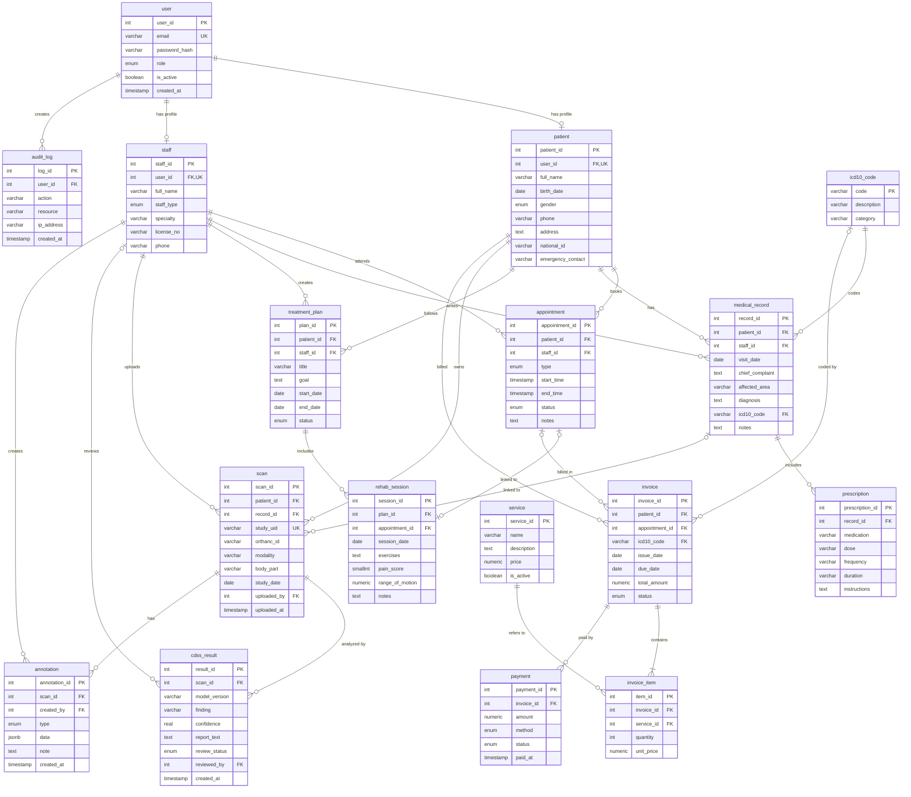

# Orthopedic and Rehabilitation System

> **DRAFT (Phase 2).** This README is a work in progress. Sections marked *(draft)* will change before the final delivery (Phase 4). Screenshots are placeholders until the screens are finished.

A web-based clinical management system for orthopedic clinics and rehabilitation centers. It manages patients, appointments, musculoskeletal electronic medical records (EMR), rehabilitation plans, billing, and reports. In Phase 3 it adds an AI-based Clinical Decision Support System (CDSS) for orthopedic scans, an interactive web DICOM viewer, and HL7 FHIR data exchange.

Course project: Healthcare Information System (HCIS), Team 03, Faculty of Engineering, Cairo University.

> This is a university prototype. It is not a certified medical product.

## Contents

1. [Project status](#project-status)
2. [Project description](#project-description)
3. [Tech stack](#tech-stack)
4. [Repository structure](#repository-structure)
5. [How to install and run (Docker Compose)](#how-to-install-and-run-docker-compose)
6. [Demo accounts](#demo-accounts-draft)
7. [Database schema](#database-schema)
8. [Demo (draft)](#demo-draft)
9. [Testing and code style](#testing-and-code-style)
10. [Team](#team)

## Project status

| Phase | Content | Status |
|---|---|---|
| 0 | System choice, tools, team, repository, code style | Done |
| 1 | Task division, system design, ER diagram, feature assignment | Done |
| 2 | Healthcare system (login, patients, appointments, EMR, billing, reports, FHIR, EMR client) | In progress |
| 3 | CDSS and DICOM system (Orthanc, OHIF viewer, AI model) | Planned |
| 4 | Final system, documentation, presentation | Planned |

## Project description

The system has three user roles with role-based access control (RBAC):

| Role | What the user can do |
|---|---|
| **Admin** | Manage user accounts, services and prices, invoices, and all reports. |
| **Clinical staff** (doctor, physiotherapist, radiologist, nurse) | Manage patients and appointments, write medical records, prescriptions, and rehabilitation plans, and (Phase 3) upload scans, run AI analysis, and annotate images. |
| **Patient** | Register, manage own profile, book appointments, see own records, plans, prescriptions, and bills, pay invoices (simulated), and (Phase 3) view own scans and reviewed AI results. |

Main features (Phase 2): JWT login, RBAC with ownership checks, appointments with overlap check, musculoskeletal EMR with ICD-10 codes, prescriptions, rehabilitation plans with pain score and range of motion, billing and simulated payments, reports with charts, HL7 FHIR R4 endpoints, and an EMR client that reads data only through FHIR.

Phase 3 features: DICOM upload (Orthanc), OHIF viewer (zoom, pan, rotate, contrast, MPR, volume rendering, filters), AI findings with clinician review, annotations, and comparison mode.

## Tech stack

| Layer | Technology |
|---|---|
| Web application | React.js (JavaScript, HTML5, CSS3), Vite, Recharts |
| EMR client | React.js, FHIR REST client |
| Backend | Python 3.12, Flask REST API, SQLAlchemy, Alembic, Flask-JWT-Extended, bcrypt |
| Database | PostgreSQL 16 |
| Authentication | JSON Web Tokens (JWT) with role-based access control |
| Interoperability | HL7 FHIR R4 (REST and JSON), ICD-10 |
| Reverse proxy | Nginx |
| AI and CDSS *(Phase 3)* | Python, PyTorch, PyDICOM, SimpleITK |
| DICOM *(Phase 3)* | Orthanc (PACS, DICOMweb), OHIF Viewer |
| Containers | Docker and Docker Compose |
| Version control and CI | Git, GitHub, GitHub Actions |
| Testing | Pytest, Jest (V-Model: unit, integration, system, acceptance) |
| Code style | black, flake8, mypy (Python); Prettier, ESLint with Airbnb (React) |
| Methodology | V-Model |

## Repository structure

```text
.
├── .github/
│   ├── workflows/ci.yml          # CI: style checks, tests, Docker smoke test
│   └── pull_request_template.md
├── backend/                      # Flask REST API, FHIR module, Alembic migrations, tests
│   ├── app/ (api/v1, models, schemas, services, fhir, utils)
│   ├── migrations/
│   ├── scripts/seed.py           # demo data
│   └── tests/ (unit, integration)
├── frontend/                     # React web application
├── emr-client/                   # React EMR client (FHIR only)
├── cdss-service/                 # AI / CDSS service (Phase 3)
├── imaging/ (orthanc, ohif)      # DICOM server and viewer settings (Phase 3)
├── nginx/default.conf            # single entry point (HTTP in development)
├── database/seed/                # ICD-10 codes and other seed files
├── docs/ (architecture, database, api, user-guides, testing, screenshots, reports)
├── docker-compose.yml
├── .env.example
└── README.md
```

## How to install and run (Docker Compose)

### Requirements

- [Git](https://git-scm.com/)
- [Docker Desktop](https://www.docker.com/products/docker-desktop/) (Windows, macOS) or Docker Engine with the Compose plugin (Linux). Docker Compose v2 is required (`docker compose`, with a space).
- Free ports: `80`, `5000`, `5173`, `5174`, `5432`.

### Steps

1. **Clone the repository** and switch to the integration branch.

   ```bash
   git clone <REPOSITORY_URL>
   cd <REPOSITORY_FOLDER>
   git checkout develop
   ```

2. **Create the `.env` file** from the example.

   ```bash
   # Linux / macOS / Git Bash
   cp .env.example .env
   # Windows PowerShell
   Copy-Item .env.example .env
   ```

3. **Change the secrets** in `.env`: `POSTGRES_PASSWORD`, `SECRET_KEY`, `JWT_SECRET_KEY`. Generate a secret with:

   ```bash
   python -c "import secrets; print(secrets.token_hex(32))"
   ```

   Also put the same database password in `DATABASE_URL` (used only when you run the backend outside Docker). Do not use the characters `@ : / #` in the database password.

4. **Build and start** all services.

   ```bash
   docker compose up --build
   ```

   On the first start, the backend applies the database migrations (`alembic upgrade head`) and, if `SEED_ON_START=true`, loads the demo data.

5. **Open the system.**

   | Service | URL |
   |---|---|
   | Web application (through Nginx) | http://localhost |
   | API health check | http://localhost/api/v1/health |
   | EMR client | http://localhost:5174 |
   | Backend directly | http://localhost:5000/api/v1/health |
   | PostgreSQL | `localhost:5432` (user and database from `.env`) |

### Useful commands

| Task | Command |
|---|---|
| Start in the background | `docker compose up -d --build` |
| Show service status | `docker compose ps` |
| Show logs of one service | `docker compose logs -f backend` |
| Stop (keep the data) | `docker compose down` |
| Stop and **delete the database** (fresh start) | `docker compose down -v` |
| Rebuild one service | `docker compose build backend` |
| Open a shell in the backend | `docker compose exec backend sh` |
| Start with the Phase 3 imaging services | `docker compose --profile imaging up --build` |

### Troubleshooting

- **`Copy .env.example to .env first`**: step 2 was skipped.
- **Port already in use**: stop the program that uses the port, or change the port mapping in `docker-compose.yml`.
- **Windows: `entrypoint.sh` errors or `\r` characters**: the file must use LF line endings. The repository has a `.gitattributes` file for this; run `git add --renormalize .` and rebuild.
- **The page does not reload after a code change on Windows**: keep `CHOKIDAR_USEPOLLING=true` in `.env`.
- **Change in `.env` is not applied**: run `docker compose up -d --force-recreate`.

## Demo accounts *(draft)*

The seed script (`backend/scripts/seed.py`) creates these accounts. They are for development only. All accounts use the demo password `Test@12345`. **Never use these accounts or this password in a real deployment.**

| Email | Role | Notes |
|---|---|---|
| `admin@hcis.test` | Admin | |
| `doctor1@hcis.test` | Clinical staff (doctor) | Has a booked appointment with patient 1 tomorrow 10:00-10:30 |
| `physio1@hcis.test` | Clinical staff (physiotherapist) | |
| `patient1@hcis.test` | Patient | Has a visit record, a rehabilitation plan, and one unpaid invoice (500.00) |
| `patient2@hcis.test` | Patient | Has own record (used to test access control) |
| `patient3@hcis.test` | Patient | Used for the login-block test |

Seed services: Consultation 300.00, Physio session 250.00, and one more imaging service. The ICD-10 table is loaded from `database/seed/icd10_codes.csv`. The seed script must be safe to run more than once (no duplicate rows).

## Database schema

The database has **17 tables** in PostgreSQL. Table and column names use lowercase `snake_case`, and table names are singular. DICOM files are not stored in PostgreSQL: the `scan` table keeps only the Orthanc ID and the DICOM Study UID.

General rules:

- All primary keys are auto-generated integers (`icd10_code` uses the code itself).
- All timestamps are in UTC.
- Foreign keys use `ON DELETE RESTRICT`, so records with history cannot be removed by mistake. Users are deactivated (`is_active = false`), not deleted.
- `audit_log` rows are never updated or deleted.
- Indexes: `patient_id`, `staff_id`, `start_time`, `study_uid`, `invoice_id`.
- `user` is a reserved word in PostgreSQL. In raw SQL write `"user"` with double quotes (SQLAlchemy does this automatically).
- The fields `uploaded_by`, `reviewed_by`, and `created_by` (in `scan`, `cdss_result`, `annotation`) point to `staff`.

| Group | Tables |
|---|---|
| Users | `user`, `patient`, `staff`, `audit_log` |
| Clinical | `appointment`, `icd10_code`, `medical_record`, `prescription`, `treatment_plan`, `rehab_session` |
| Imaging and AI (Phase 3) | `scan`, `cdss_result`, `annotation` |
| Billing | `service`, `invoice`, `invoice_item`, `payment` |



Notes on the diagram: `PK` = primary key, `FK` = foreign key, `UK` = unique. Lines show the multiplicity (for example, one patient has zero or many appointments). The full data dictionary with types and rules is in the Phase 1 report (Table 3). The schema is created by the Alembic migrations in `backend/migrations`. **If a migration changes a table, update this section in the same pull request.**

## Demo *(draft)*

Only the main screens are shown. The screenshots below are placeholders (shown as alt text) and will be replaced when the screens are finished. Phase 3 screens (DICOM viewer, AI results) will be added later.

### 1. Login page

<!-- TODO(screenshot 1): replace the placeholder below with:   -->
> **[Screenshot placeholder 1]** `docs/screenshots/01-login.png`
> **Alt text:** Login page of the Orthopedic and Rehabilitation System with email and password fields and a Login button.
> **Account:** Any role (Section: Authentication, F01)

### 2. Patient portal dashboard

<!-- TODO(screenshot 2): replace the placeholder below with:   -->
> **[Screenshot placeholder 2]** `docs/screenshots/02-patient-dashboard.png`
> **Alt text:** Patient dashboard showing upcoming appointments, the latest medical record, the active rehabilitation plan, and unpaid bills.
> **Account:** patient1@hcis.test (F12)

### 3. Appointment booking

<!-- TODO(screenshot 3): replace the placeholder below with:   -->
> **[Screenshot placeholder 3]** `docs/screenshots/03-appointment-booking.png`
> **Alt text:** Appointment booking screen with doctor selection, a calendar of free time slots, and a confirmation button. A conflict message is shown for a busy slot.
> **Account:** patient1@hcis.test (F05)

### 4. Visit record with ICD-10

<!-- TODO(screenshot 4): replace the placeholder below with:   -->
> **[Screenshot placeholder 4]** `docs/screenshots/04-visit-record-icd10.png`
> **Alt text:** Staff screen for a new visit record with chief complaint, affected area, diagnosis, ICD-10 code search box, and a prescription section.
> **Account:** doctor1@hcis.test (F06, F07, B1)

### 5. Rehabilitation plan and sessions

<!-- TODO(screenshot 5): replace the placeholder below with:   -->
> **[Screenshot placeholder 5]** `docs/screenshots/05-rehab-plan-sessions.png`
> **Alt text:** Rehabilitation plan page with goal and dates, and a table of sessions showing pain score and range of motion for each visit.
> **Account:** physio1@hcis.test (F08)

### 6. Invoice and payment

<!-- TODO(screenshot 6): replace the placeholder below with:   -->
> **[Screenshot placeholder 6]** `docs/screenshots/06-invoice-payment.png`
> **Alt text:** Invoice details page with service lines, total amount, ICD-10 code, status badge, and a Pay button with the simulated payment form.
> **Account:** patient1@hcis.test (F09, F10)

### 7. Admin reports dashboard

<!-- TODO(screenshot 7): replace the placeholder below with:   -->
> **[Screenshot placeholder 7]** `docs/screenshots/07-admin-reports.png`
> **Alt text:** Admin dashboard with charts for appointment load, diagnoses by ICD-10 code, and monthly revenue plus unpaid invoices.
> **Account:** admin@hcis.test (F11)

### 8. EMR client (FHIR)

<!-- TODO(screenshot 8): replace the placeholder below with:   -->
> **[Screenshot placeholder 8]** `docs/screenshots/08-emr-client-fhir.png`
> **Alt text:** EMR client application listing patients and their appointments loaded only through the FHIR endpoints.
> **Account:** doctor1@hcis.test (F15)

## Testing and code style

The project follows the V-Model: unit tests (Pytest, Jest), integration tests (API and services), system tests (end to end), and acceptance tests (final demo). The test cases and their results are in `docs/testing/test-cases.xlsx`.

```bash
# Backend (inside the running container)
docker compose exec backend black --check .
docker compose exec backend flake8 .
docker compose exec backend mypy app
docker compose exec backend pytest

# Frontend
docker compose exec frontend npm run lint
docker compose exec frontend npm test
```

Code style (defined in Phase 0): PEP 8 with black, flake8, and mypy for Python; Airbnb style with Prettier and ESLint for React; lowercase `snake_case`, singular table names, and uppercase SQL keywords for the database; Conventional Commits for Git messages (for example `feat: add patient login endpoint`).

Git workflow: `main` (stable), `develop` (integration), and `feature/F05-appointments` style branches named after the feature ID. Every pull request to `develop` needs one approval and a green CI check (GitHub Actions: `.github/workflows/ci.yml`).

## Team

| Member | Position |
|---|---|
| Ahmed Osama Ashmawy Mohamed | Medical Imaging and DICOM Developer |
| Hussein Mohamed Hussein Saleh | Backend Developer |
| Amr Fekry El-Sayed Mohamed | Database and HL7/FHIR Integration Engineer |
| Anas Mohamed Abdelaziz El-Sheikh | Frontend Developer |
| Mazen Atef Awad Atlam | Team Leader, AI and CDSS Engineer |
